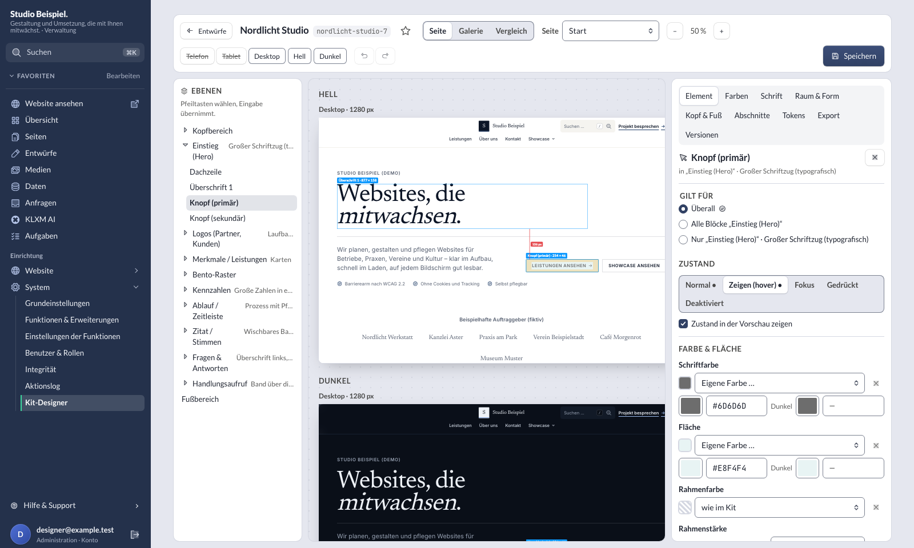
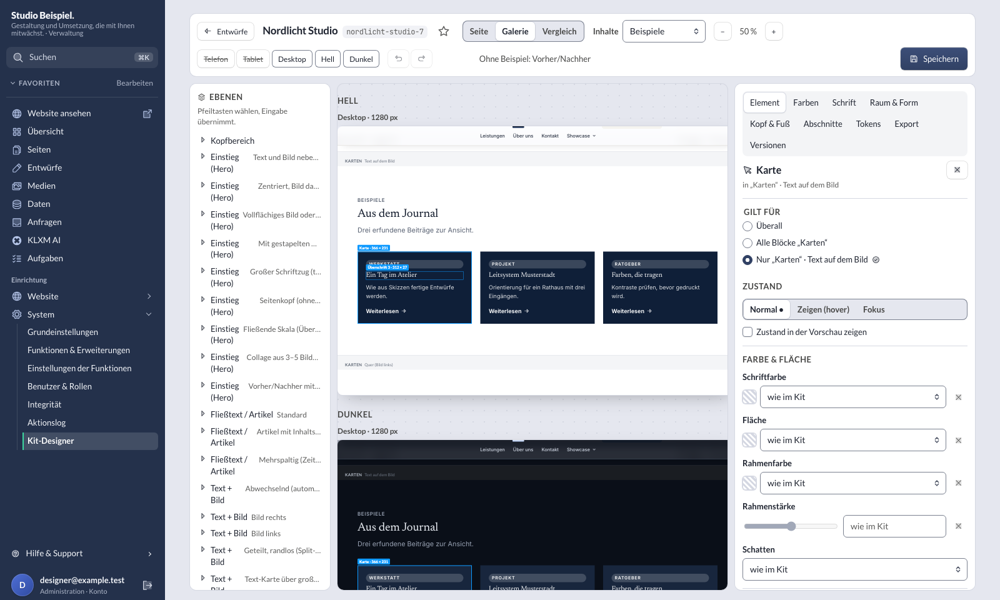
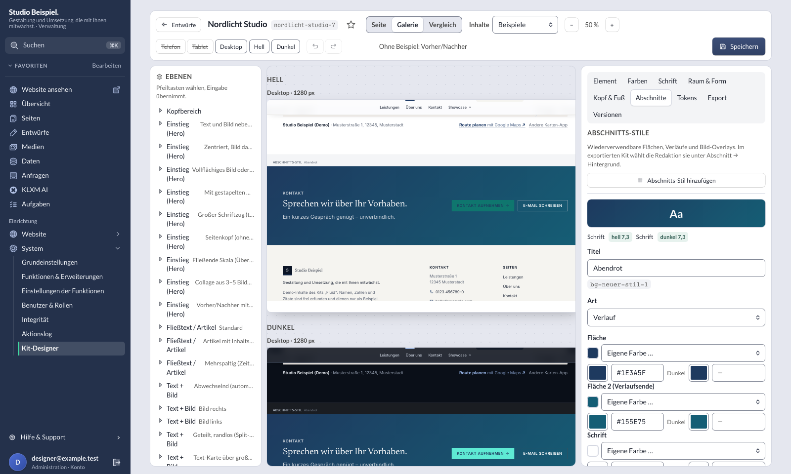
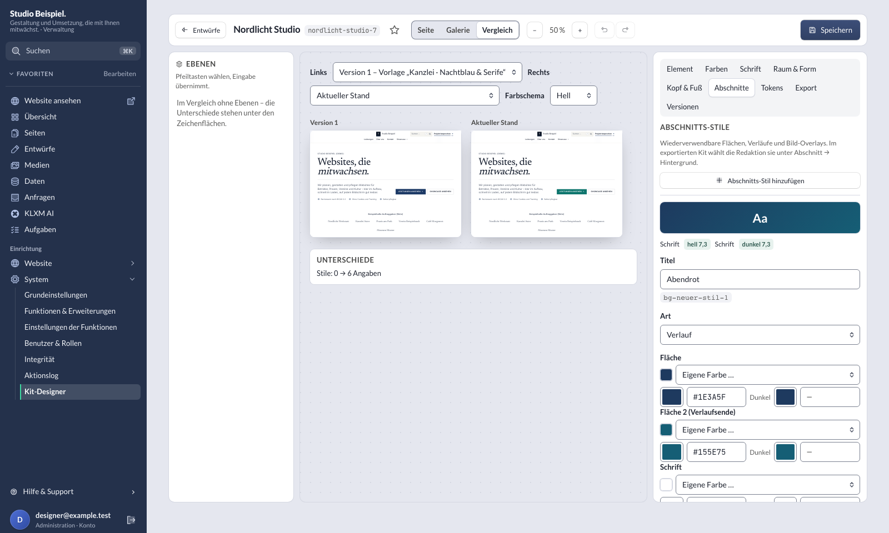
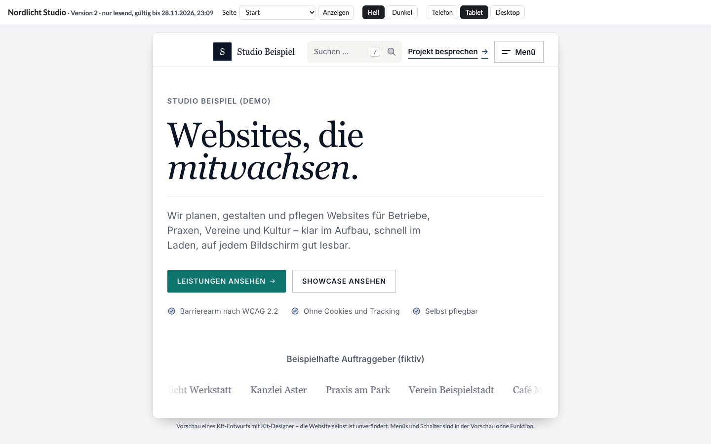

# KLXM Studio – Kit-Designer (`kit_designer`)

Kits gestalten wie in einem Design-Werkzeug: **Farben** mit Live-Kontrastprüfung und automatisch vorgeschlagener Dunkel-Fassung,
**Schriften**, Schriftstufen und Zeilenhöhe, **Abstände, Rundungen, Schatten, Inhaltsbreite**, Kopf- und Fußvarianten – und das Ergebnis
sofort auf **echten Seiten** der Website sehen: Telefon, Tablet und Desktop, hell und dunkel nebeneinander. Fertige Entwürfe gehen als
**Kind-Kit von fluid** hinaus – für KLXM Studio und für REDAXO fluid. Design-Tokens kommen im **W3C-Format (DTCG)** herein und hinaus,
z. B. aus Figma mit Tokens Studio.

Ab 0.2.0 wie in Figma: **Elemente direkt in der Vorschau anklicken** und gestalten – je Zustand (hover, Fokus, gedrückt, deaktiviert) und
wahlweise überall, für einen Blocktyp oder nur eine Variante –, eine **Komponenten-Galerie** aller Blöcke von fluid, **Abschnitts-Stile**
(Flächen, Verläufe, Bild-Overlays), **Rückgängig/Wiederholen**, **Vergleich** zweier Stände und **Vorschau-Links** zum Teilen.

Die Website ändert sich dabei nicht: Vorschau und Rechnung laufen nur im Speicher; erst ein exportiertes und gewähltes Kit wirkt.



## Installation

```bash
composer require klxm/studio-kit-designer   # oder das Repository nach extensions/kit_designer klonen bzw. verknüpfen
php bin/console extensions:publish          # gebaute Dateien nach public/assets/ext/kit_designer
php bin/console migrate --all               # Tabellen kit_designer_drafts, kit_designer_versions
```

Einschalten je Website unter **Administration → Funktionen & Erweiterungen** oder in der Konfiguration: `'extensions' => ['kit_designer']`.
Das Kit **fluid** muss in der Installation vorhanden sein (Eltern-Kit). Recht: **„Kits gestalten“** (`kit_designer.design`, Standard nur
Administration). Direkt installieren dürfen nur Personen, die die Installation verwalten (`Core\KitPackages::canManage()`).

## Arbeitsweise

1. **Werkzeuge → Kit-Designer → Neuer Entwurf** – aus einer Vorlage von fluid, dem aktuellen Design der Website, einer Token-Datei, einem
   installierten Kind-Kit von fluid oder einem Export (ZIP) des Kit-Designers zum Weiterbearbeiten.
2. Grundlagen gestalten: Reiter Farben, Schrift, Raum & Form, Kopf & Fuß. Die Kontrastprüfung (WCAG 2.2 AA: Schrift 4,5 : 1, Grafik und
   Bedienelemente 3 : 1) läuft mit; „Beheben“ korrigiert ein Paar, „Dunkel-Fassung vorschlagen“ leitet alle dunklen Werte ab.
3. Elemente gestalten: in der Vorschau anklicken (oder links unter **Ebenen** wählen) → Reiter **Element**: Geltung, Zustand, Farben aus dem
   Design oder eigene (mit Dunkel-Wert), Schrift, Form, Abstände, Fokusrahmen – mit Kontrast je Zustand und Maßen.
4. **Galerie**: alle Blöcke von fluid in jeder Variante mit erfundenen Beispielen – Stile blockweise festlegen. **Abschnitte**: wiederverwendbare
   Hintergründe für die Redaktion.
5. **Speichern** (Strg/⌘ + S) – jede Speicherung ist eine Version; **Vergleich** zweier Stände, **Vorschau-Link** zum Teilen (nur lesend, befristet).
6. **Export** (nur ohne Kontrastmängel): ZIP für KLXM Studio, direkt installieren (`storage/kits/{name}`) oder ZIP für REDAXO fluid.



| Abschnitts-Stile | Vergleich zweier Stände | Vorschau-Link (ohne Anmeldung) |
|---|---|---|
|  |  |  |

### Tastatur

| Kürzel | Wirkung |
|---|---|
| Strg/⌘ + S | Speichern (neue Version) |
| Strg/⌘ + Z · Umschalt + Strg/⌘ + Z (oder Strg + Y) | Rückgängig · Wiederholen |
| Pfeiltasten, Pos1/Ende, Eingabe (Ebenen) | Element wählen, Gruppen auf- und zuklappen |
| Alt + ↑ / Alt + ↓ | übergeordnetes bzw. erstes enthaltenes Element wählen |
| Esc | Auswahl aufheben |

## Was der Export enthält

| KLXM Studio (`{name}/`) | REDAXO fluid (`src/Kit/{Name}/`) |
|---|---|
| `theme.php` mit `'extends' => 'fluid'` und `design_defaults` (nur Abweichungen, auch Zeilenhöhe `line_height`) | `{Name}Kit.php` mit `#[AsKit('name', 'Titel', parent: 'fluid')]` |
| `'css' => ['css/kit.css']`: Element- und Abschnitts-Stile zusätzlich zum CSS von fluid | `kit.php` legt die Standardwerte über `$parent['design']`; `'css' => ['css/kit.css']` |
| `'conditional_css' => ['css/kd-{typ}.css' => ['{typ}']]`: Stile je Block, nur auf Seiten mit dem Block | `'assets' => ['css/kd-{typ}.css' => ['{typ}']]` |
| `'backgrounds'` / `'dark_backgrounds'`: Abschnitts-Stile als Hintergründe | `'backgrounds'` / `'dark_backgrounds'` (an die von fluid angehängt) |
| `composer.json` (Typ `klxm-studio-kit`), `design-tokens.json`, `kit-designer.json`, `README.md`, `LICENSE` | `design-tokens.json`, `kit-designer.json`, `README.md`, `LICENSE` |

`kit-designer.json` enthält den ganzen Entwurf (Werte, Stile, Abschnitts-Stile) – damit lässt sich ein exportiertes Kit wieder einlesen und
weiterbearbeiten. Auf einem Core ohne `'css'` für Kind-Kits schreibt der Export wie in 0.1 `css/site.css` mit `@import` von fluid.

**REDAXO fluid einspielen:** ZIP im Projekt entpacken (der Ordner landet unter `src/Kit/{Name}/`, wie bei `bin/console fluid:kit:create`),
den Namensraum an den PSR-4-Eintrag für `src/` anpassen (beim Export wählbar, Standard `Project`), `bin/console cache:clear`,
`bin/console migrate`, dann **Website-Einstellungen → Kit** wählen. Hatte die Website eigene Design-Werte im Kit fluid, unter Design auf
„Standard“ gehen, damit die Werte des neuen Kits gelten.

## Prüfen

```bash
php bin/console kit_designer:selftest --site=…      # Farben, Tokens, Entwürfe, Stile + Kontrast je Zustand, Export Studio + REDAXO,
                                                    # Installation + kit:check, Import, Vorschau-Links, Galerie (114 Prüfungen)
php bin/console i18n:missing en --extension=kit_designer
```

## Voraussetzungen

KLXM Studio ab 1.0.0 mit dem Kit **fluid**. Am besten mit einem Core, der `Theme::withKit()`, `'css' => [...]` für Kind-Kits, das fluid-Token
`line_height` (`--f-lh`) und `KitPackages::check` ohne `templates/`-Pflicht kennt – ältere Stände von 1.0.0 funktionieren mit Rückfall
(Zeilenhöhe und Stile über `css/site.css`).

## Stufen

Stufe 1 (0.1): Design-Grundlagen eines Kind-Kits von fluid. Stufe 2 (0.2, diese Fassung): Elemente, Blöcke, Zustände, Abschnitts-Stile, Galerie,
Vergleich, Teilen, Import. Später: Seiten aus Blöcken zusammenklicken, eigene Block-Varianten, weitere Eltern-Kits (z. B. native).

## English

**Kit Designer** for KLXM Studio: design a kit visually – colours with live WCAG 2.2 AA contrast checks and an automatically suggested dark
version, fonts, type scale and line height, spacing, radius, shadows and content width – and see the result on real pages of the website
(phone, tablet and desktop, light and dark side by side) without changing the site. Import and export design tokens in the W3C Design Tokens
Community Group format (e.g. from Figma via Tokens Studio). Export the design as a child kit of fluid for KLXM Studio (ZIP or direct install)
and for REDAXO fluid (ZIP in the `fluid:kit:create` layout); export is blocked until all colour pairs pass AA.

Since 0.2.0 it works like Figma: click elements in the preview (hover outlines, selection with size, padding and distances) and style them
per state (hover, focus, active, disabled) – everywhere, per block type or per variant – with token-bound colours, type, shape and spacing and a
contrast check per state. A layers panel (keyboard operable), a component gallery of all fluid blocks and variants with invented sample content,
reusable section styles (fills, gradients, image overlays) that editors pick as section backgrounds, undo/redo, side-by-side comparison of two
versions and time-limited read-only preview links. Exports now include element, block and section styles (`'css'`, per-block CSS,
`backgrounds`) for both KLXM Studio and REDAXO fluid, and exported kits can be imported again for further editing.

Lizenz: MIT (siehe [LICENSE](LICENSE)).
